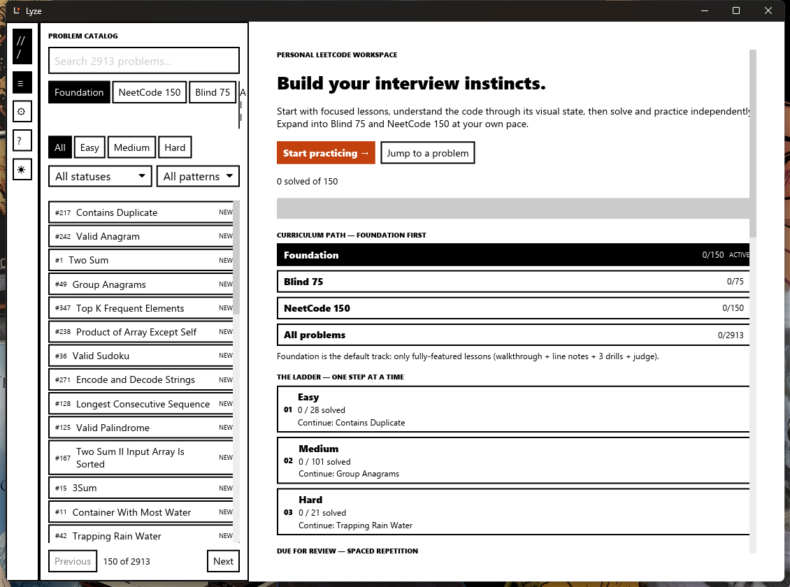
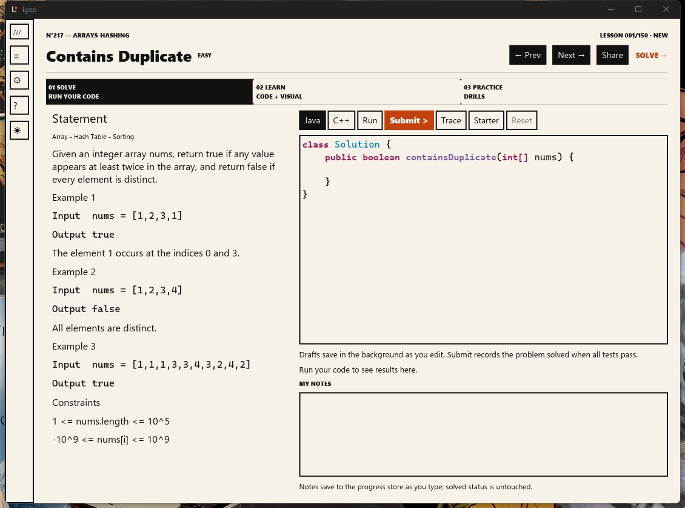

# Lyze — native LeetCode Lab desktop app

A fast, offline, native desktop app for grinding LeetCode: browse 2,913
problems, solve in Java or C++ with a real bundled judge, watch
step-by-step visual walkthroughs, and drill deterministic Practice variants
with spaced-repetition tracking. No browser, no WebView, no account, no
network — one 17 MB executable plus bundled toolchains.




## Install (Windows)

No installer needed. Grab the portable build from **Releases**
(`LeetCodeLab-win-x64.zip`), unzip anywhere **without spaces in the path**
(e.g. `C:\Lyze` — the bundled MinGW driver cannot parse spaced paths),
and run `LeetCodeLab/leetlab-app.exe`. First launch creates its profile
under `%LOCALAPPDATA%\LeetCodeLab`.

## Build from source

Requirements: Rust toolchain, x64 Visual Studio Developer PowerShell
(MSVC linker), JDK + `g++` on `PATH` for the compiler-backed tests.

```powershell
cargo fmt --manifest-path desktop/Cargo.toml --all -- --check
cargo check --manifest-path desktop/Cargo.toml --workspace --locked
# tests need a writable temp dir inside the checkout:
$env:TMP='desktop/target/cargo-tmp'; $env:TEMP='desktop/target/cargo-tmp'
cargo test --manifest-path desktop/Cargo.toml --workspace --locked
# headless app gate (no window): state, lessons, Java + C++ judging, cancel/timeout
desktop/packaging/test-headless.ps1
leetlab-app --check-resources -- "<repo root>"
```

Stage a releasable tree + zip (close the app first — Windows locks the
running exe):

```powershell
cargo build --locked --offline --release -p leetlab-app   # run from desktop/
python desktop/packaging/stage.py --os win --app-bin desktop/target/rel-r4/release/leetlab-app.exe --vendor desktop/target/vendor --out desktop/target/pkg-win-final
python desktop/packaging/package.py --os win --stage desktop/target/pkg-win-final
```

## What's inside

| Path | What it is |
|---|---|
| `desktop/crates/app` | Iced shell: catalog, Solve/Learn/Practice/Settings/Trace, judge, tracer, drafts, progress |
| `desktop/crates/core` · `learning` | Catalog index/shards/NEETCODE track · lesson fixtures (150 walkthroughs + variants) |
| `desktop/fixtures/` | Fixture tooling (`export-*.mjs`, `new-problem-check.mjs`) + `catalog-extra.json` v2 |
| `desktop/lessons/v1/` | Curated overlay specs for judge-null / external lessons |
| `desktop/packaging/` | `stage.py`, `package.py`, `test-headless.ps1`, `leetlab.iss`, `vendor/` (Temurin JDK + MinGW-w64) |
| `plugin/data/` | 2,913-problem dataset: `index.json` + `shard-*.json` (**read-only**) |
| `plugin/web/engine/` | Fixture generators (`walkthrough.js`, `variants.js`, forges). The shipped app never runs this code |
| `plugin/host/judge.js` · `trace.js` | Reference the Rust judge/tracer were ported from |
| `docs/NEETCODE_150.json` | First-release track membership (read by the app) |
| `DESIGN.html` | The visual contract: annotated light/dark sheets + pattern invariants + release scope. Open in a browser |
| `AGENTS.md` | The single agent playbook |

## Add a problem

`node desktop/fixtures/new-problem-check.mjs [slug]` is the gate: `READY`
means the judge spec (mode, signature types, tests) fits the harness and
the lesson opens + grades today. The full 150-lesson curriculum ships with
captured frames and 3 graded drills each; every other judge-backed problem
opens with Solve + grading and an honest fallback — proven by
`non_curriculum_judge_problems_degrade_gracefully`.

Judge types: `int long double float boolean string char int[] long[] double[]
boolean[] char[] int[][] char[][] string[][] ListNode ListNode[] TreeNode
Node GraphNode void` (+ `mutates` for void). Modes: `exact unordered float
any graph`. `Node` has two slug-scoped shapes (graph adjacency vs
random-pointer pairs) with one harness branch each.

## Current state

First release target: NeetCode 150 + Blind 75 (see `docs/NEETCODE_150.json`).
Release gate: 134/134 judge parity, full suite green, headless gate green,
per-slug acceptance before any VERIFIED_COMPLETE claim. Still open:
interactive smoke pass, clean-room installs, Inno installer, C++ from
spaced checkouts (use a space-free path).

## Contributing

Read `AGENTS.md` first — one file, one workflow. Keep the app dependency-free
of browsers, WebViews, and network calls. Never synthesize judge results or
walkthrough frames; show the documented fallback instead.
