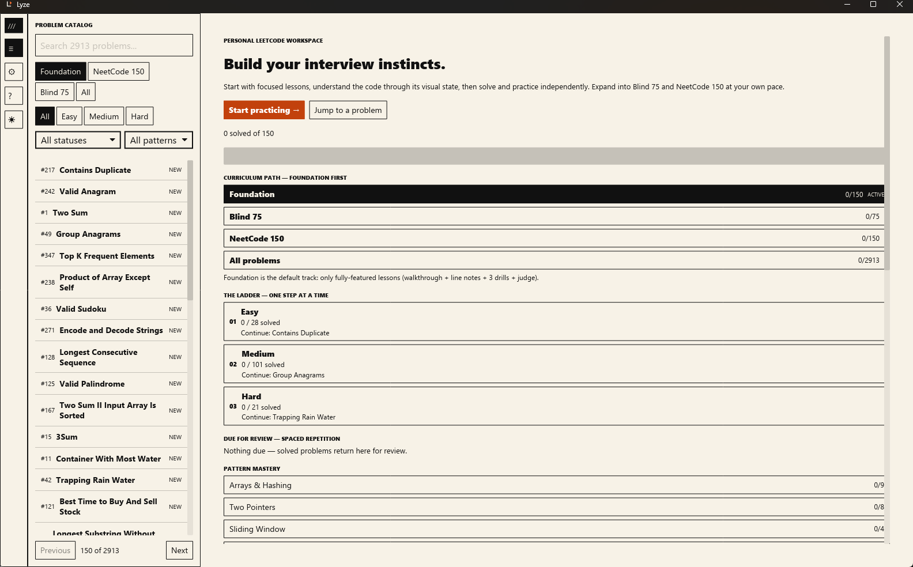
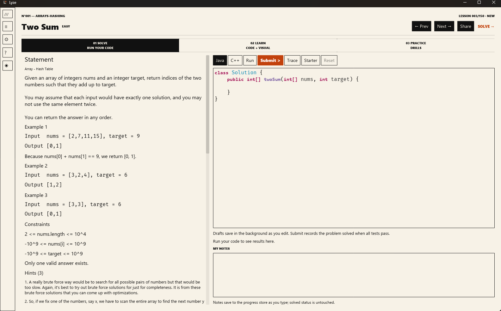
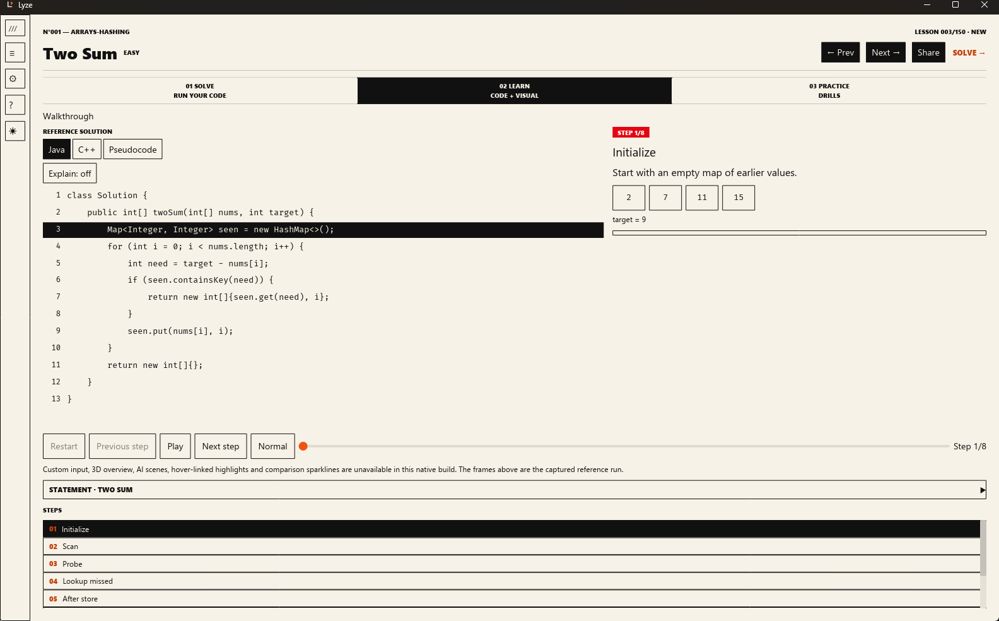
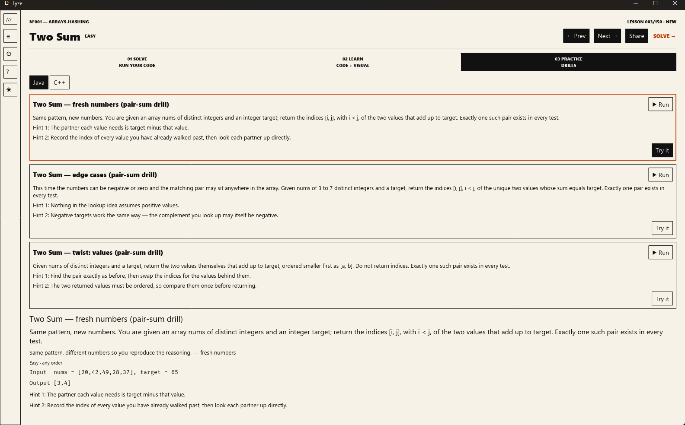
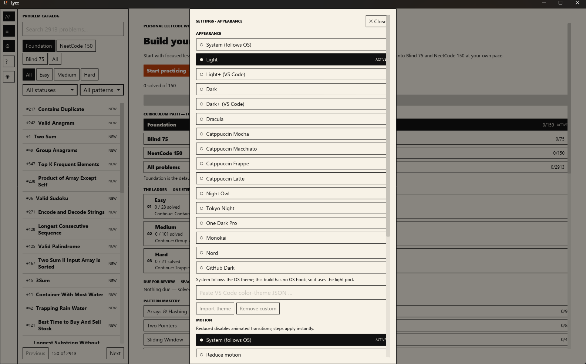

# Lyze


A fast, offline desktop app for actually grinding LeetCode. Browse 2,913 problems, solve in Java or C++ with a real local judge, watch step-by-step visual walkthroughs, and drill Practice variants. No browser, no WebView, no account, no network — just one ~17 MB exe plus bundled toolchains.




## Download

Grab it from [**Releases**](https://github.com/RaiyanRafi07/lyze/releases) — download `LeetCodeLab-win-x64.zip`, unzip anywhere, run `LeetCodeLab/leetlab-app.exe`.

A couple things I learned the hard way:

- Unzip somewhere **without spaces in the path** (e.g. `C:\Lyze`). The bundled MinGW driver doesn't like spaced paths.
- First launch creates its profile under `%LOCALAPPDATA%\LeetCodeLab`. Your progress and drafts stay on your machine.

No installer, no admin needed.

## Why I built this

I was tired of grinding in a browser tab — slow, distracting, and useless on a plane. I wanted something that opens instantly, judges code for real with `javac` / `g++`, and shows me what's actually happening with visualizations instead of just "Wrong Answer."

So Lyze is native Rust (Iced), fully offline. The problem set, walkthroughs, and NeetCode track ship with the app.

## Features

- **2,913 problems** offline — full catalog with search and filters
- **Real judging** — Java + C++ compiled and run locally, not mocked
- **Learn mode** — 150 NeetCode walkthroughs with step frames tied to reference code lines
- **Practice mode** — 3 graded drills per lesson + fallback for every other judge-backed problem
- **Progress + drafts** — spaced repetition tracking, all local in `%LOCALAPPDATA%`
- **Trace view** — step through execution state visually
- **Themes** — 16 built-ins (Dracula, Catppuccin, Night Owl, Tokyo Night, One Dark Pro, Monokai, Nord, GitHub Dark, VS Code Dark+/Light+) plus paste-any VS Code color-theme JSON to import your own





## Build from source

You'll need Rust, the x64 MSVC linker, plus JDK and `g++` on `PATH` for the compiler-backed tests.

```powershell
cargo fmt --manifest-path desktop/Cargo.toml --all -- --check
cargo check --manifest-path desktop/Cargo.toml --workspace --locked

# tests need a writable temp dir inside the checkout:
$env:TMP='desktop/target/cargo-tmp'
$env:TEMP='desktop/target/cargo-tmp'
cargo test --manifest-path desktop/Cargo.toml --workspace --locked

# headless app gate (no window):
desktop/packaging/test-headless.ps1
leetlab-app --check-resources -- "<repo root>"
```

To make a release zip (close the app first — Windows locks the running exe):

```powershell
cargo build --locked --offline --release -p leetlab-app   # run from desktop/
python desktop/packaging/stage.py --os win --app-bin desktop/target/rel-r4/release/leetlab-app.exe --vendor desktop/target/vendor --out desktop/target/pkg-win-final
python desktop/packaging/package.py --os win --stage desktop/target/pkg-win-final
```

## What's inside

| Path | What it is |
|---|---|
| `desktop/crates/app` | Iced UI — catalog, Solve / Learn / Practice / Settings / Trace, judge, tracer |
| `desktop/crates/core` · `learning` | Catalog index/shards/NeetCode track · lesson fixtures |
| `desktop/fixtures/` | Dev tooling (`export-*.mjs`, `new-problem-check.mjs`) + `catalog-extra.json` |
| `desktop/lessons/v1/` | Overlay specs for judge-null / external lessons |
| `desktop/packaging/` | `stage.py`, `package.py`, `test-headless.ps1`, `leetlab.iss`, vendor notes |
| `plugin/data/` | 2,913-problem dataset (`index.json` + `shard-*.json`, read-only) |
| `plugin/web/engine/` | Reference fixture generators. Shipped app never runs this code |
| `plugin/host/judge.js` · `trace.js` | Reference the Rust judge/tracer were ported from |
| `docs/` | `NEETCODE_150.json` track + screenshots + `DESIGN.html` visual spec |
| `DESIGN.html` | The visual contract — annotated light/dark sheets + patterns. Open in a browser |

## Adding a problem

`node desktop/fixtures/new-problem-check.mjs [slug]` is the gate. `READY` means the judge spec (mode, signature types, tests) fits the harness and the lesson opens + grades today.

Judge types: `int long double float boolean string char int[] long[] double[] boolean[] char[] int[][] char[][] string[][] ListNode ListNode[] TreeNode Node GraphNode void` (+ `mutates` for void). Modes: `exact unordered float any graph`.

## Roadmap

- [x] NeetCode 150 + Blind 75 track (`docs/NEETCODE_150.json`)
- [x] 134/134 judge parity, full suite green, headless gate green
- [ ] Interactive smoke pass on clean Windows installs
- [ ] Inno installer
- [ ] C++ from spaced checkouts (for now use a space-free path)

Per-slug acceptance before I mark anything `VERIFIED_COMPLETE` — no fake greens.

## Contributing

PRs welcome. Open `DESIGN.html` in a browser before touching pixels (it's the visual source of truth), and skim `AGENTS.md` for the workflow. Keep it dependency-free of browsers, WebViews, and network calls. Never fake judge results or walkthrough frames — show the honest fallback instead.

## License

MIT — see [LICENSE](LICENSE). Problems belong to their respective owners; this is a study tool.
